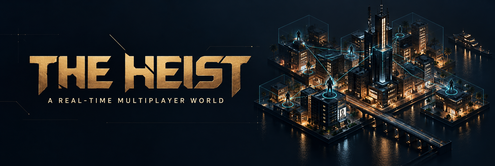
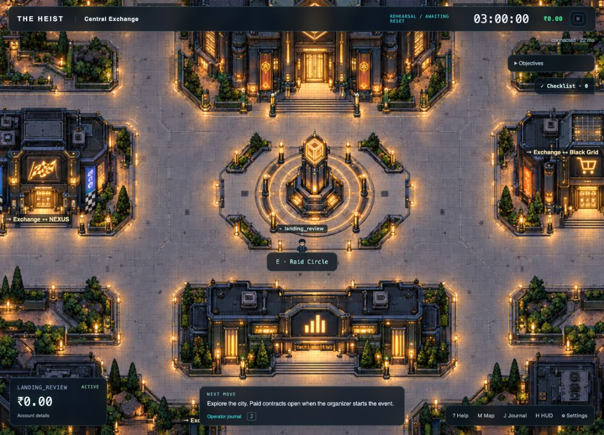
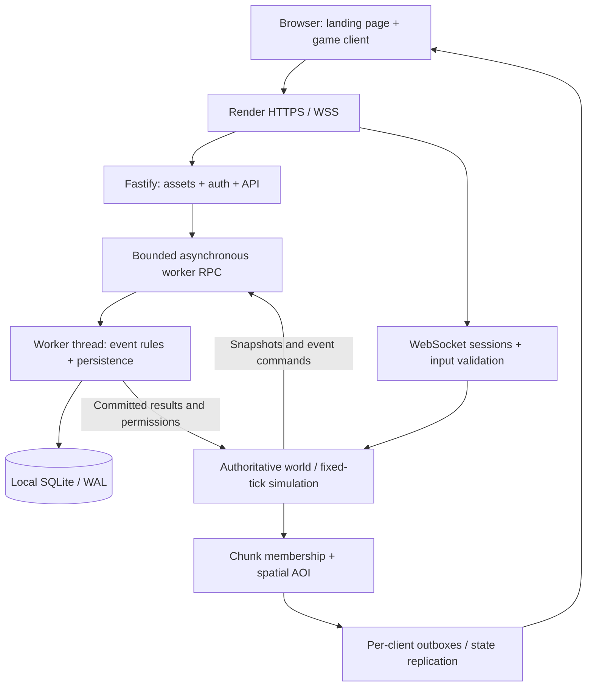
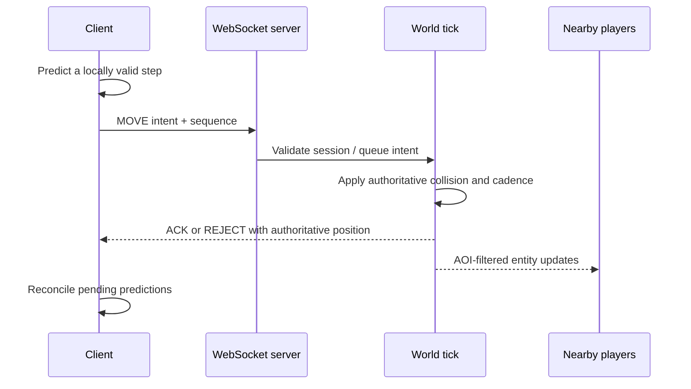

<p align="center">
  
</p>

# THE HEIST · Veyra City

**Explore a shared cybercity. Take contracts. Build wealth. Decide what to risk.**

THE HEIST is a browser-based, top-down multiplayer game—and an engineering project about making a shared world responsive, consistent and measurable. Its six districts connect exploration, coding and puzzle challenges, a player economy, Homes and timed events. Beneath the city is an authoritative TypeScript server with fixed-tick simulation, spatial replication and SQLite persistence isolated in a worker thread.

[The game](#the-game) · [Architecture](#architecture) · [Benchmarks](#measured-backend-performance) · [Run locally](#run-locally) · [Deploy on Render](docs/RENDER_DEPLOYMENT.md)

## The game

The idea started with a concurrent multiplayer backend: could a small, readable top-down world stay responsive while many players move and interact at once? The project grew through team-built city artwork, game interfaces and challenge systems into Veyra City. This portfolio iteration brings that world together with a polished entry page, operator animations, contextual HUD and reproducible engineering evidence.

| Explore | Take on challenges | Build and protect |
| --- | --- | --- |
| Six districts, seven connectors and six residential wards | 42 challenge templates across 17 workbench types | Contracts, wealth, banking, Homes and risk/reward decisions |
| Central Exchange, Tech Quarter, Black Grid, Nexus Plaza, Data Harbor and Undercity | Coding, debugging, CTF and puzzle interactions | Raids, races and Golden Hour event systems |

Four-direction movement, a following camera and nearby interaction prompts keep the game approachable. The artwork stays visible; menus appear when they are useful. A fresh server begins in the **lobby**. An owner starts the timed round through Event Control before paid activities become available.



## Engineering highlights

- **Server-owned state.** Clients submit intent; the server validates movement, collision, interaction distance, contract results and money. Shared codecs and simulation rules prevent client/server protocol drift.
- **Fixed-tick world simulation.** A 20 Hz default world loop processes queued movement. Client prediction and reconciliation make movement feel immediate without granting the browser authority.
- **Spatial interest management.** Chunk membership and a 3×3 neighbourhood determine who receives entity enter, leave and movement updates. Batched replication avoids broadcasting the whole city to everyone.
- **Recoverable sessions.** Heartbeats, bounded movement queues, transport backpressure and a 30-second disconnected-player ghost window support reconnects without rebuilding the player from scratch.
- **Database work off the movement thread.** A bounded asynchronous RPC queue delegates SQLite and the event engine to a worker. Synchronous SQL executes there, while the main thread continues processing movement and sockets.
- **Transactional economy.** WAL, foreign keys, an append-only ledger, staff audit records, reset archives and round-fenced position snapshots preserve the relationship between game actions and stored state.
- **Observable behaviour.** Tick timing, ACK latency, bandwidth, process memory, event-loop behaviour and database queue health are measured alongside correctness checks—not just connection counts.

## Architecture

One deployable service serves the website, game assets, HTTP API and WebSocket endpoint. No separate frontend host or external database is required.



The tick does **not** await SQL. The worker owns the database connection and event transactions; the main thread holds authoritative positions and a committed movement-permission cache. Pending RPCs are bounded at 1,024; worker loss rejects outstanding work and disables movement rather than allowing the world to diverge. A database lease enforces one active writer per world.



**Stack:** TypeScript · Node.js 22 · Fastify · WebSocket (`ws`) · Canvas 2D · Vite · SQLite (`node:sqlite`) · worker threads · Vitest · Docker.

For persistence details, schema choices and failure handling, see [SQLite architecture](docs/SQLITE_PORTFOLIO.md). The event aggregate intentionally remains a versioned JSON snapshot in SQLite; ledger/history are relational rows, with SQL views for inspection.

<!-- measured-benchmark:start -->
## Measured backend performance

The core world engine passed a **15-minute soak with 500 actively moving simulated players**.

| Measurement | Observed result |
| --- | ---: |
| Sustained logical protocol deliveries, inbound + outbound | **32,727 / second** |
| Movement-to-ACK latency, p95 | **54.85 ms** |
| World-tick execution, p95 | **8.515 ms / 50 ms budget** |
| Acknowledged moves during the soak | **1,442,904** |
| Exact entity/position reconnect recovery | **500 / 500** |
| Mean server RSS | **70.29 MiB** |
| AOI fan-out reduction, matched 100-player distributed workload | **96.81%** |

**What these numbers mean:** a validated operating point for the core world engine on Apple M1 / 8 GiB RAM / Node 22.19.0, with bots and server co-located on loopback. Throughput counts logical packet deliveries including recipient copies, not unique player actions. AOI reduction compares deliveries per acknowledged move against a global-replication baseline.

The core benchmark excludes the event/contract scheduler. A separate **40-player full-game lobby/workbench run** passed, and earlier paid-gameplay validation covered jobs, deposits, races and settlement. The **1,000-player core run failed stability gates** and is retained in the report. These are not hardware-independent capacity claims or Render Free capacity measurements; the demo is configured for 60 players.

[Full methodology, passing and failing runs](docs/benchmarks/RESULTS.md) · [Machine-readable evidence](docs/benchmarks/results.json) · [Validation summary](docs/benchmarks/VALIDATION.md) · [SQLite/gameplay validation](docs/SQLITE_VALIDATION.md)
<!-- measured-benchmark:end -->

## Run locally

Use **Node.js 22.19.0** and npm. From the repository root:

```sh
npm ci
npm run build:deploy
```

Copy `.env.example` to `.env` if you do not already have one. Keep `DATABASE_BACKEND=sqlite` and `DB_URL=sqlite:./data/heist.db`. For first-boot owner access, add a private `HEIST_ADMIN_USERNAME` and `HEIST_ADMIN_PASSWORD` of at least 12 characters. Existing accounts/passwords are never overwritten by bootstrap.

```sh
node apps/server/dist/main.js
```

Open **http://localhost:8080/**. Register a player or sign in as the configured owner; use Event Control to start the round. No MongoDB setup is needed. If reusing an older `.env`, remove `EVENT_DB_PATH` and replace its MongoDB selection with SQLite.

For live editing, run `npm run build:shared`, then `npm run dev:server` and `npm run dev:client` in separate terminals. Open **http://localhost:5173/**; Vite proxies the API and WebSocket to port 8080.

## Deployment

The root [Dockerfile](Dockerfile) builds the frontend and backend together. [render.yaml](render.yaml) configures one free Docker web service, a generated owner password, `/health`, and deployment after CI passes. The server listens on VM's `PORT` and serves HTTP and WebSocket traffic on the same origin.


Local container preview:

```sh
docker build -t the-heist .
docker run --rm -p 8080:10000 the-heist
```

This preview uses disposable storage. Render Free storage is also intentionally ephemeral: losing demo accounts/progress when the instance is replaced is acceptable for this project. See the [deployment guide](docs/RENDER_DEPLOYMENT.md) for owner setup, verification and optional local persistence.

## Validation and benchmarks

Normal CI checks the deployable build, client types, shared protocol/simulation tests, server regressions and closed-dialog visibility. Extended UI/world audits and bot-harness tests remain available through the manual **Extended validation** workflow. Long load tests do not delay every deployment.

```sh
npm run test:shared
npm run test:server
npx tsc -p apps/client/tsconfig.json --noEmit

# Optional harness tests and a disposable core-engine benchmark
npm run build:bots
npm run test:bots
npm run benchmark -- --players=100 --seconds=180 --warmup=30 --engine=core
```

Benchmark outputs include environment metadata, latency distributions and correctness results. Use the [reproduction guide](docs/benchmarks/RESULTS.md#reproduce) for the complete campaign. Raw fixture files contain test credentials; only the sanitized published results belong in public evidence.

## Repository guide

| Path | Responsibility |
| --- | --- |
| `apps/client` | Landing page, canvas renderer, HUD, prediction and interaction UI |
| `apps/server` | Auth, WebSocket transport, world simulation, event rules and SQLite worker |
| `packages/shared` | Binary codecs, movement/collision, map and chunk math |
| `apps/bots` | Simulated clients, gameplay validation and benchmark harness |
| `maps` | Authoritative world/collision data aligned to the artwork |
| `docs/benchmarks` | Published measurements, methodology and validation |

## Project history

The original **The Heist** focused on the real-time core and bot testing. **The Heist 2.0** expanded it through collaborative game, UI and city-asset work; the current portfolio pass adds server-local SQLite, presentation polish and measured backend evidence. This is a team-built game with a backend-engineering focus.

Historical detail remains in [PROJECT_HANDOFF.md](PROJECT_HANDOFF.md), [GAMEPLAY_HANDOFF.md](GAMEPLAY_HANDOFF.md) and [the Azure runbook](docs/AZURE_VM_HOSTING.md). Their MongoDB/event-hosting instructions describe earlier phases; use this README and the Render/SQLite guides for the current setup. The old Azure deployment workflow is manual-only.
